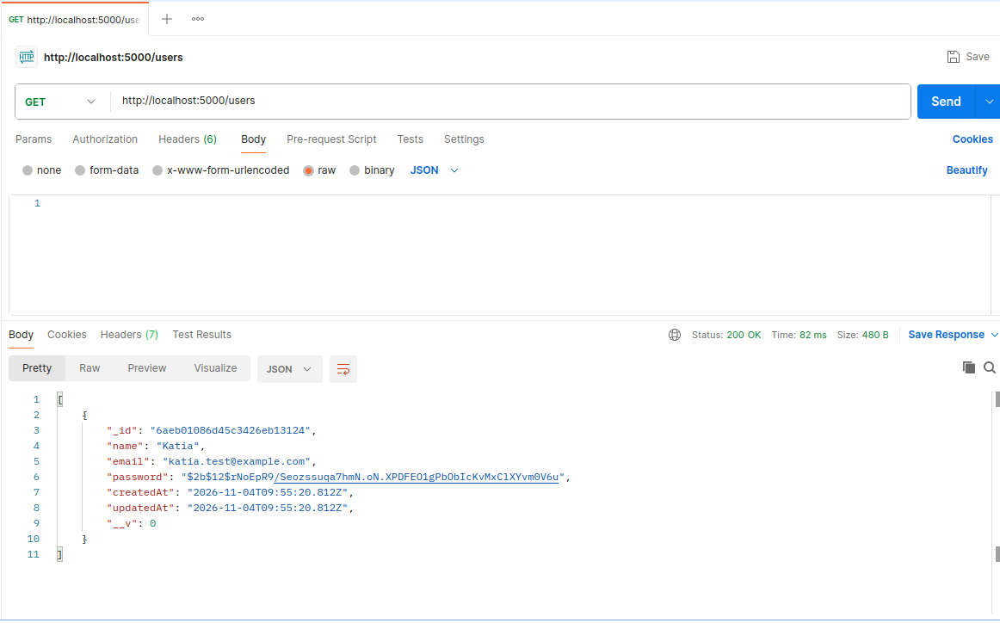
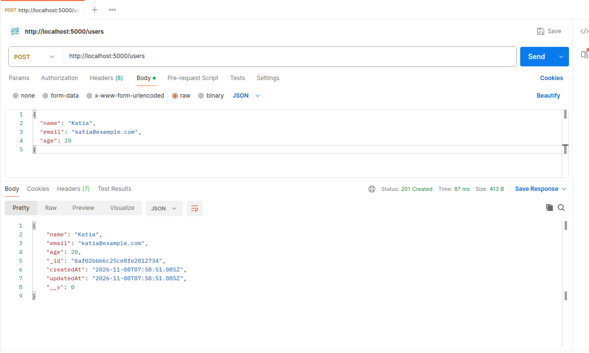
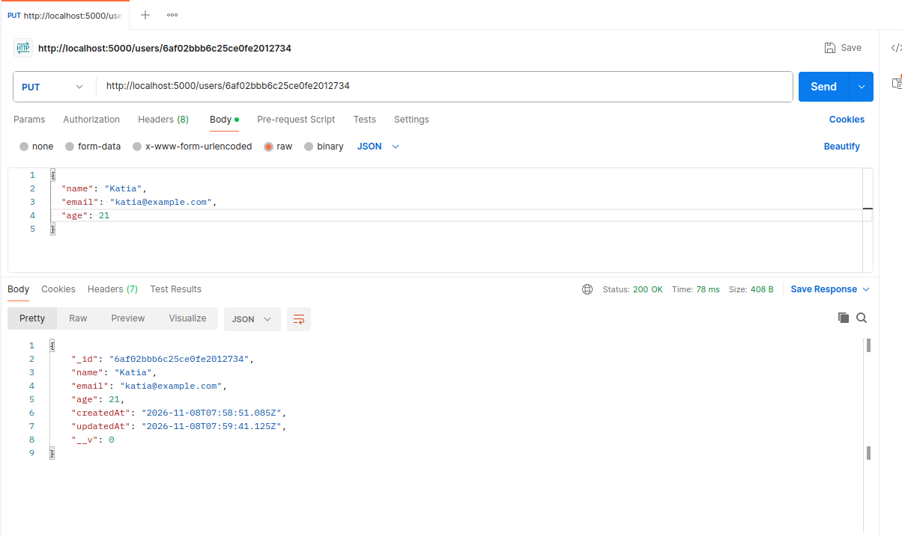
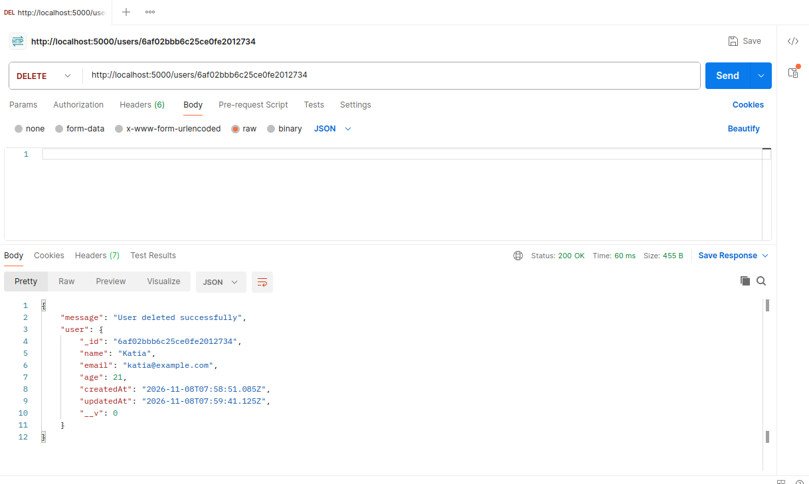

# GMC REST API Checkpoint

A simple REST API built with **Node.js, Express, MongoDB, and Mongoose** to perform CRUD operations on users.

## Features

The API provides four routes:

| Method | Route        | Description         |
| ------ | ------------ | ------------------- |
| GET    | `/users`     | Retrieve all users  |
| POST   | `/users`     | Add a new user      |
| PUT    | `/users/:id` | Update a user by ID |
| DELETE | `/users/:id` | Delete a user by ID |

## Testing with Postman

The four API routes were tested using Postman.

### Test 1 – GET: Retrieve All Users

### Test 2 – POST: Add a New User

### Test 3 – PUT: Update a User

### Test 4 – DELETE: Remove a User

